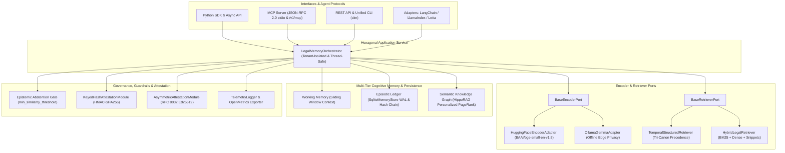

# Continuous Legal Memory (CLM)

[](https://github.com/vfcarida/continuous-legal-memory/actions/workflows/ci.yml)
[](https://www.python.org/downloads/)
[](LICENSE)
[](#technical-architecture-overview)
[](#model-context-protocol-mcp--rest-microservice)

**Continuous Legal Memory (CLM)** is an open-source, bi-temporal cognitive memory and normative compliance framework for legal AI agents and regulated enterprise systems.

Unlike general-purpose agent memory layers (`mem0`, `letta`, `graphiti`) that treat stored knowledge as flat vector chunks, CLM embeds **formal statutory interpretation canons** (*lex superior*, *lex specialis*, *lex posterior*, and explicit `SUPERSEDES` graph relations), **bi-temporal validity** (`valid_time` vs. `transaction_time`), **HippoRAG Personalized PageRank graph diffusion**, **calibrated epistemic abstention** (EU AI Act Art. 14), and **cryptographically attested GDPR Article 17 erasure** (HMAC-SHA256 & RFC 8032 Ed25519) into a deterministic, sub-10ms engine with native **Model Context Protocol (MCP)** interoperability.

---

## Technical Architecture Overview



---

## Core Capabilities

### 1. Tri-Canon Deontic Precedence & Conflict Resolution
- ***Lex Superior Derogat Legi Inferiori* (`authority_rank`)**: Constitutional and federal statutes strictly override subordinate corporate policies or client preferences, regardless of recency.
- ***Lex Specialis Derogat Legi Generali* (`specificity`)**: Within matching authority tiers, more specific regulatory clauses override general provisions.
- ***Lex Posterior Derogat Legi Priori* (`valid_from` *in pari materia*)**: Within matching authority and specificity tiers, chronologically newer provisions on the same subject matter supersede older provisions.
- **Explicit `SUPERSEDES` Graph Suppression**: Direct statutory amendments (`metadata={"supersedes": ...}` or `RelationType.SUPERSEDES`) deterministically suppress superseded rules.

### 2. Epistemic Abstention Guardrails (EU AI Act Article 14)
- **Calibrated Refusal Path**: When query-to-memory cosine similarity falls below `min_similarity_threshold`, `orchestrator.predict()` refuses to extrapolate and returns `abstained=True`, a zeroed action vector, and a diagnostic `abstention_reason` alongside `max_similarity`.

### 3. Bi-Temporal Multi-Tier Cognitive Memory, Hybrid Citation Pinpointing & HippoRAG Diffusion
- **Working Memory**: Capacity-bounded sliding window for active session context.
- **Strict Bi-Temporal Ledger (`at_time` $\times$ `as_of_transaction_time`)**: Append-only chronological ledger with SHA-256 hash chaining supporting dual-axis queries across **valid time** (`valid_from` / `valid_to`) and **transaction time** (`as_of_transaction_time`) alongside historical `AppendOnlyMerkleLog.get_root_as_of()` replay.
- **Hybrid Lexical-Dense Retrieval (`HybridLexicalCitationScorer`)**: Combines Okapi BM25+ lexical scoring with multi-jurisdictional statutory pin-cite extraction (`Art. 17(3)(b) GDPR`, `28 U.S.C. § 1332`, `Lei 13.709/2018 Art. 7`) inside `TemporalStructuredRetriever`.
- **Semantic Knowledge Graph + HippoRAG PPR**: Entity-typed legal graph (`STATUTE`, `CLAUSE`, `CASE_PRECEDENT`, `OBLIGATION`, `PROHIBITION`, `PERMISSION`) supporting `CONTRADICTS`, `DEPENDS_ON`, and `SUPERSEDES` edges with acyclic guards and multi-hop Personalized PageRank diffusion (`orchestrator.associate_statutes()`).

### 4. GDPR Article 17 Right-to-Erasure, Sparse Merkle Proofs & Defeasible Proof Traces (EU AI Act Art. 12, 13 & 86)
- **Personal Data Confinement**: Records marked `personal_data=True` never touch neural parameters (`skip_parametric=True`).
- **256-Bit Sparse Merkle Tree Erasure Proofs**: `orchestrator.delete_rule(record_id)` purges matching records across all tiers and generates an RFC 6962 cryptographic non-membership proof (`merkle_non_membership_proof`) persisted in SQLite WAL.
- **Defeasible Proof-Tree Explanation (`DefeasibleProofTrace`)**: Every prediction generates a SHA-256 hashed derivation trace (`result.proof_trace`) recording candidate evaluation and the exact canon (`DEFEATED_BY_SUPERSEDES`, `DEFEATED_BY_LOIS_DE_POLICE`, `DEFEATED_BY_LEX_SUPERIOR`, `DEFEATED_BY_LEX_SPECIALIS`, `DEFEATED_BY_LEX_POSTERIOR`, `EXCLUDED_TRANSACTION_TIME`) for every competing norm.
- **Dual Cryptographic Attestation**: Supports symmetric **HMAC-SHA256** (`KeyedHashAttestationModule`) and zero-trust asymmetric **RFC 8032 Ed25519** digital signatures (`AsymmetricAttestationModule`).

### 5. Strict Multi-Tenant Isolation & SQLite WAL Persistence
- **Zero Cross-Tenant Leakage**: Tenant boundaries (`tenant_id` and `with orchestrator.tenant("firm_a"):`) isolate Working Memory, Episodic Ledgers, and Semantic Knowledge Graphs (`0.00%` cross-tenant leakage verified in adversarial benchmarks).
- **ACID Persistence**: `SqliteMemoryStore` operates with Write-Ahead Logging (`PRAGMA journal_mode = WAL`) for concurrent thread-safe persistence via `save_to_disk()` and `load_from_disk()`.

### 6. Model Context Protocol (MCP), REST Microservice & Agent Ecosystem Interoperability
- **Native MCP Server (`continuous_legal_memory.mcp.MCPServer`)**: Exposes JSON-RPC 2.0 tools (`legal_memory_ingest`, `legal_memory_predict`, `legal_memory_erase`, `legal_memory_associate`, `legal_memory_verify`, `legal_memory_audit_consistency`) and resources (`clm://context/{tenant_id}`, `clm://graph/{tenant_id}`, `clm://metrics`) over stdio (`clm mcp`) and HTTP (`POST /v1/mcp`).
- **REST API & CLI Parity**: Exposes `/v1/rules`, `/v1/predict`, `/v1/audit/consistency`, `/v1/merkle/root`, `/v1/merkle/proof/{id}`, `/v1/merkle/verify`, and `/v1/conformal/calibrate` over HTTP and `clm` CLI subcommands.
- **Framework Adapters**: Drop-in integrations for **LangChain** (`ContinuousLegalMemoryLangChain`), **LlamaIndex** (`ContinuousLegalMemoryLlamaRetriever`), and **Letta / MemGPT** (`ContinuousLegalMemoryBlock`).

---

## Installation

```bash
git clone https://github.com/vfcarida/continuous-legal-memory.git
cd continuous-legal-memory

# Standard installation (Python 3.10+)
pip install -e .

# Developer & test suite installation
pip install -e ".[dev]"
```

---

## Quickstart

### Python SDK: Tri-Canon Precedence, Abstention & Ed25519 Attestation

```python
from datetime import datetime, timezone
from continuous_legal_memory import (
    AsymmetricAttestationModule,
    LegalMemoryOrchestrator,
)
from continuous_legal_memory.adapters.mock_encoder import SemanticMockEncoder

# Initialize deterministic structured orchestrator with Ed25519 attestation & abstention guardrail
attestor = AsymmetricAttestationModule()
orchestrator = LegalMemoryOrchestrator(
    encoder=SemanticMockEncoder(embedding_dim=64),
    value_dim=2,  # [DELETE, RETAIN]
    engine_mode="structured",
    attestor=attestor,
    min_similarity_threshold=0.25,
)

with orchestrator.tenant("bank_eu"):
    # 1. Subordinate internal policy (Authority Rank 2 -> DELETE)
    orchestrator.update_memory(
        rule_text="Internal Policy: Delete customer credit transaction logs after 6 months.",
        action_vector=[1.0, 0.0],
        authority_rank=2,
        valid_from=datetime(2025, 1, 1, tzinfo=timezone.utc),
    )

    # 2. Superior statutory mandate (Authority Rank 9 -> RETAIN)
    orchestrator.update_memory(
        rule_text="AML Banking Statute: Retain customer credit transaction logs for 5 years.",
        action_vector=[0.0, 1.0],
        authority_rank=9,
        valid_from=datetime(2020, 1, 1, tzinfo=timezone.utc),
    )

    # Query: Lex superior ensures Rank 9 statute prevails over newer Rank 2 policy
    result = orchestrator.predict("Customer demands deletion of credit transaction logs.")
    print(f"Governing Rule: {result.most_relevant_rule}")
    print(f"Decision Vector (Delete, Retain): {result.predicted_action_vector}")
    print(f"Abstained: {result.abstained} (Max Sim: {result.max_similarity:.3f})")
    print(f"Ed25519 Signature Verified: {attestor.verify_attestation(result.attestation_token, result)}")
```

### Model Context Protocol (MCP) & REST Microservice

```bash
# Launch MCP JSON-RPC 2.0 server over stdio for Claude Desktop / Cursor / MCP clients
clm mcp --db-path ./legal_memory.db --enable-attestation --mock-encoder

# Launch multi-threaded REST API server (includes POST /v1/mcp and GET /metrics)
clm serve --host 127.0.0.1 --port 8000 --db-path ./legal_memory.db --enable-telemetry --mock-encoder
```

---

## Empirical Evaluation & Maturity Summary

Continuous Legal Memory includes a reproducible multi-seed evaluation harness (`continuous_legal_memory/evaluation/harness.py`), a 540-case Multi-Jurisdictional Statutory Graph Benchmark (`continuous_legal_memory/evaluation/multijurisdictional.py` covering `EU`, `US`, and `BR` with RAGAS and DeepEval adapters), and a LegalBench-RAG contract evaluation suite (`continuous_legal_memory/evaluation/legalbench_eval.py`). Full methodology and ablation tables are documented in [`docs/evaluation_report.md`](docs/evaluation_report.md) and [`ROADMAP.md`](ROADMAP.md).

| Baseline Architecture | Overall Accuracy | Authority Correctness | Catastrophic Forgetting (BWT) | Poisoning ASR | Multi-Tenant Leakage |
| :--- | :---: | :---: | :---: | :---: | :---: |
| **No-Memory** | `0.235 ± 0.000` | `0.200 ± 0.000` | `+0.000 ± 0.000` | N/A | N/A |
| **Bounded-History ($k=3$)** | `0.765 ± 0.000` | `0.800 ± 0.000` | `+0.000 ± 0.000` | N/A | N/A |
| **Plain RAG (Vector-Only)** | `0.794 ± 0.000` | `0.600 ± 0.000` | `+0.000 ± 0.000` | `33.33%` | `100.00%` |
| **Temporal Structured (Default Engine)** | **`0.882 ± 0.000`** | **`0.800 ± 0.000`** | **`+0.000 ± 0.000`** | **`0.00%`** | **`0.00%`** |
| **Hybrid Continuum Memory (`Experimental`)** | `0.760 ± 0.045` | `0.540 ± 0.092` | `+0.110 ± 0.118` | `0.00%` | `0.00%` |

### v1.2.0 Capabilities (`Stable`)
- **Cryptographic Timestamp Authority (RFC 3161) & Transparency Log Gossip (`TransparencyGossipAuditor`):** `issue_timestamp_token()` and `audit_transparency_gossip()` (`continuous_legal_memory/security/timestamp_gossip.py`) issue signed RFC 3161-inspired `TimestampToken`s over the tenant's 256-bit `SparseMerkleTree` root and `AppendOnlyMerkleLog` head, and audit cross-witness `GossipCheckpoint`s to detect split-view equivocation and history rollback (`POST /v1/merkle/timestamp`, `POST /v1/merkle/gossip-audit`, MCP `legal_memory_issue_timestamp` / `legal_memory_gossip_audit`, `clm timestamp-root` / `clm gossip-audit`).
- **Automated Statutory Diff & Downstream Amendment Impact Analysis (`StatutoryAmendmentAnalyzer`):** `analyze_statutory_amendment()` (`continuous_legal_memory/reasoning/amendment_impact.py`) computes clause-level diffs (`ClauseDiffSpan`), tracks deontic modality shifts (`OBLIGATION` $\leftrightarrow$ `PROHIBITION` $\leftrightarrow$ `PERMISSION`), and traces the transitive compliance blast radius across subordinate contracts and corporate policies (`POST /v1/rules/amendment-impact`, MCP `legal_memory_amendment_impact`, `clm amendment-impact`).
- **End-to-End Post-Quantum Hybrid Attestation (`PQ-Hybrid-Ed25519-SHA256`):** `PostQuantumHybridAttestationModule` (`continuous_legal_memory/security/pq_hybrid.py`) combines classical RFC 8032 `Ed25519` with a 67-chain ($w=16$) Winternitz **WOTS+-SHA256** (RFC 8391 / NIST FIPS 205) post-quantum hash-based signature across `CryptographicKeyRing`, `SelectiveDisclosureProver`, `PortableBundleManager`, `FederatedComplianceVerifier`, `TEEAttestationProvider`, `TransparencyGossipAuditor`, and `SparseMerkleProof`.
- **Bi-Temporal Regulatory Horizon Simulator (`TemporalHorizonSimulator`):** `simulate_temporal_horizon()` (`continuous_legal_memory/reasoning/temporal_simulator.py`) sweeps across all `valid_from` phase-in and `valid_to` sunset boundaries within a target window to forecast deontic modality transitions (`O`, `F`, `P`), prevailing canons, and future horizontal antinomies (`POST /v1/rules/timeline`, MCP `legal_memory_simulate_timeline`, `clm simulate-timeline`).
- **Client-Side Standalone Audit Verifier (`StandaloneAuditVerifierExporter`) & OpenAPI 3.1.0 Specification:** `export_standalone_verifier()` (`continuous_legal_memory/security/standalone_verifier.py`) generates a self-contained, zero-dependency HTML5 + WebCrypto single-file audit bundle & SMT-LIB inspector (`POST /v1/audit/standalone-verifier`, MCP `legal_memory_export_verifier`, `clm export-verifier`), while `GET /v1/openapi.json` exposes the full OpenAPI 3.1.0 specification.
- **Formal SMT-LIB 2.6 Theorem Prover Export Bridge (`SMTLibDeonticExporter`):** `export_smtlib()` (`continuous_legal_memory/reasoning/smtlib_exporter.py`) compiles active tenant norms and `DefeasibleProofTrace` derivations (`winning_canon`) into self-contained **SMT-LIB 2.6** (`QF_UFLIA`) specifications for external verification in **Z3** and **cvc5** (`POST /v1/audit/smtlib`, MCP `legal_memory_export_smtlib`, `clm export-smtlib`).
- **Hardware/TEE Enclave Remote Attestation (`TEEAttestationProvider`) & Normative Drafting Co-Pilot (`NormativeDraftingCopilot`):** `generate_tee_quote()` binds the tenant's 256-bit `SparseMerkleTree` root and active signing key into **AWS Nitro Enclaves (`PCR0..PCR2`)** and **Intel TDX (`MRTD`/`RTMR0..1`)** quotes, while `propose_norm_repairs()` synthesizes and re-verifies conflict-free legislative/contractual repair options (`EXPLICIT_SUPERSESSION`, `LEX_SPECIALIS_CARVEOUT`, `TEMPORAL_PARTITION`, `DAG_CYCLE_PRUNING`).
- **Global Multi-Jurisdictional Choice-of-Law Router (`EU`, `US`, `BR`, `UK`, `SG`, `JP`, `CH`) & Split-Conformal Prediction:** `ChoiceOfLawRouter` resolves Private International Law conflicts (*lois de police* overriding mandatory provisions across 7 sovereign regimes), `NormativeGraphExtractor` supports multilingual (`EN`, `PT`, `FR`, `DE`) deontic extraction, and `SplitConformalCalibrator` constructs finite-sample $(1 - \alpha)$ prediction sets (`result.conformal_set`).

---

## Scientific & Regulatory Foundations

1. **Associative Knowledge Graph Memory:** Gutiérrez et al., *"HippoRAG: Neurobiologically Inspired Long-Term Memory for Large Language Models"*, **NeurIPS 2024** (`arXiv:2405.14831`).
2. **Test-Time Surprise & Dual-Timescale Memory:** Behrouz et al., *"Titans: Learning to Memorize at Test Time"*, **Google Research**, 2024 (`arXiv:2501.00663`).
3. **Legal RAG Reliability & Hallucination Risk:** Magesh et al., *"Hallucination-Free? Assessing the Reliability of Leading AI Legal Research Tools"*, **Stanford RegLab / Journal of Empirical Legal Studies**, 2024 (`arXiv:2405.20362`).
4. **Legal Reasoning & Retrieval Benchmarks:** Guha et al., *"LegalBench"*, **NeurIPS 2023** (`arXiv:2308.11462`); Pipitone & Alami, *"LegalBench-RAG"*, 2024 (`arXiv:2408.10343`).
5. **Conformal Prediction & Risk Control:** Vovk, Gammerman & Shafer (2005); Angelopoulos & Bates (2023); Angelopoulos et al., *"Conformal Risk Control"*, **ICLR 2024** (`arXiv:2208.02814`).
6. **Regulatory & Cryptographic Standards:** **EU AI Act (Regulation 2024/1689)** Articles 12 & 14; **GDPR (Regulation 2016/679)** Article 17; **RFC 6962** (Certificate Transparency Merkle Hash Trees) & **RFC 8032** (Ed25519).

---

## Verification & Quality Gates

```bash
# Run the complete unit and integration test suite
pytest -v

# Run static type checking
mypy continuous_legal_memory

# Run Ruff linter across source, tests, and examples
ruff check continuous_legal_memory tests examples
```

---

## License & Acknowledgments

Released under the [MIT License](LICENSE). See [`ROADMAP.md`](ROADMAP.md) for engineering governance and [`CITATION.cff`](CITATION.cff) for academic citation metadata.

*Designed and architected by [Vinicius Caridá](https://github.com/vfcarida). Implementation and verification accelerated with AI-assisted engineering workflows.*
